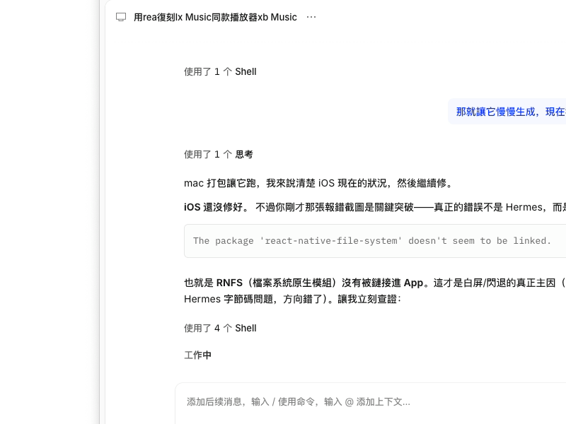
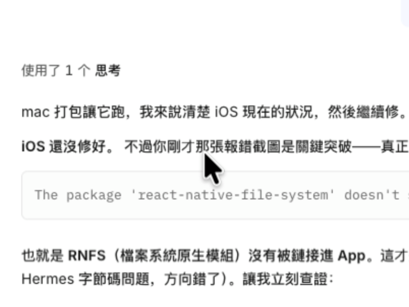

# xiaobaiRec 自检录像 · Dwell-Zoom Demo

xiaobaiRec（macOS 区域/窗口录屏工具）的**鼠标晃动自动放大（dwell-zoom）**功能自检录像。

## 这段录像展示了什么

自检模式全自动完成，无人为操作：
程序自动开一段 800×600 区域录制 → 程序化晃动光标（±40pt 来回 ≈ 2.8cm 振幅）→ 停止录制。

- **0–3s**：光标停在录制区外/未晃动 → 画面保持 1×
- **~3s**：晃动被识别（方向翻转 ≥4 次 + 轨迹半径 40–50pt）→ 画面在 ~0.7s 内平滑推近到 2.0×，中心跟随鼠标
- **~12s**：录制停止

日志摘录：

```
zoomdiag  flips=7 exc=48          ← 晃动识别中
dwell-zoom engaged flips=9 exc=49 ← 触发放大
zoom 1.00 → 1.82 → 1.99           ← 平滑推近
finishWriting done status=2 ✅
```

## 放大前后帧对比（同一视频抽取）

| 放大前 (t=1s, zoom=1.0) | 放大后 (t=9s, zoom=2.0) |
|---|---|
|  |  |

## 技术要点

- 触发判定：近 2 秒鼠标轨迹的**方向交替次数**（不限画圈，来回往复即可），振幅对应物理 2–4cm
- 放大实现：ScreenCaptureKit `SCStream.updateConfiguration` 动态调整 `sourceRect`，系统侧 GPU 完成，零逐帧 CPU 开销，帧率不掉
- 坐标系：CG 顶左原点统一定位鼠标与捕获区域，按显示器边界匹配修正

## 相关文件

- `xiaobaiRec-录制-20261018-134102.mp4` — 自检实录（800×600，约 13.5s）
- `before-zoom.png` / `after-zoom.png` — 帧 1 与 帧 9 的对比截图
